# SchoolStoreCasher

Offline-first cashier and inventory app for a school store. Scan items, link each sale to a student, teacher or grade, take cash or wallet payments, and see what sells. Everything runs in the browser and is saved on the same computer, so no server or internet connection is needed.

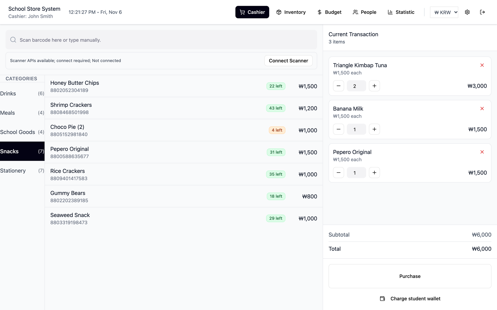

<sub>All screenshots use invented demo data (fictional students, products and sales).</sub>

**At a glance**

- **Cashier**: scan or tap products, then scan the buyer's ID card. One scan finishes the sale.
- **Student wallet**: students pre-load cash and earn 2% cashback on every purchase.
- **Teacher self-checkout**: teachers scan a shared barcode and buy without the password.
- **Inventory**: stock levels, low-stock warnings, restocks that log their own expense.
- **Budget**: revenue, expenses and profit for any date range.
- **People**: students and teachers, printable barcode cards, CSV import.
- **Statistics**: what sells, what to restock, who buys, and when the counter is busiest.
- **Backups**: one-click backup file plus an automatic copy on disk.

**Contents**

[Selling](#selling) · [Student wallet](#student-wallet) · [Teacher self-checkout](#teacher-self-checkout) · [Inventory](#inventory) · [Budget](#budget) · [People](#people) · [Statistics](#statistics) · [Barcode scanners](#barcode-scanners) · [Login and sessions](#login-and-sessions) · [Backups and data](#backups-and-data) · [Run it](#run-it) · [Configuration](#configuration)

---

## Selling

The **Cashier** page is split in two. On the left is the product picker: a search box ("Scan barcode here or type manually."), a category list with item counts, and the products in that category with their barcode, price and a stock badge (orange at 4 or fewer, greyed out when sold out). On the right is the cart.

**A sale, step by step**

1. **Add items.** Scan a product barcode anywhere on the page, type in the search box, or tap a product. Use − / + to change quantities. The cart won't go above the stock on hand.
2. **Press Purchase.** A "Who is buying?" dialog opens with the total.
3. **Scan the buyer's barcode** (student or teacher card). No card? Tap their grade instead. Every sale is linked to someone, and picking the buyer completes the sale.
4. **Wallet check.** If the buyer is a student with at least ₩100 in their wallet, the app asks how much to take from it. Pay part or all from the wallet, or press **Pay all in cash**.
5. **Receipt.** Shows items, how it was paid, cashback earned and the new wallet balance. **Print**, **Download**, or **Close & New Transaction**.

<table>
  <tr>
    <td width="33%">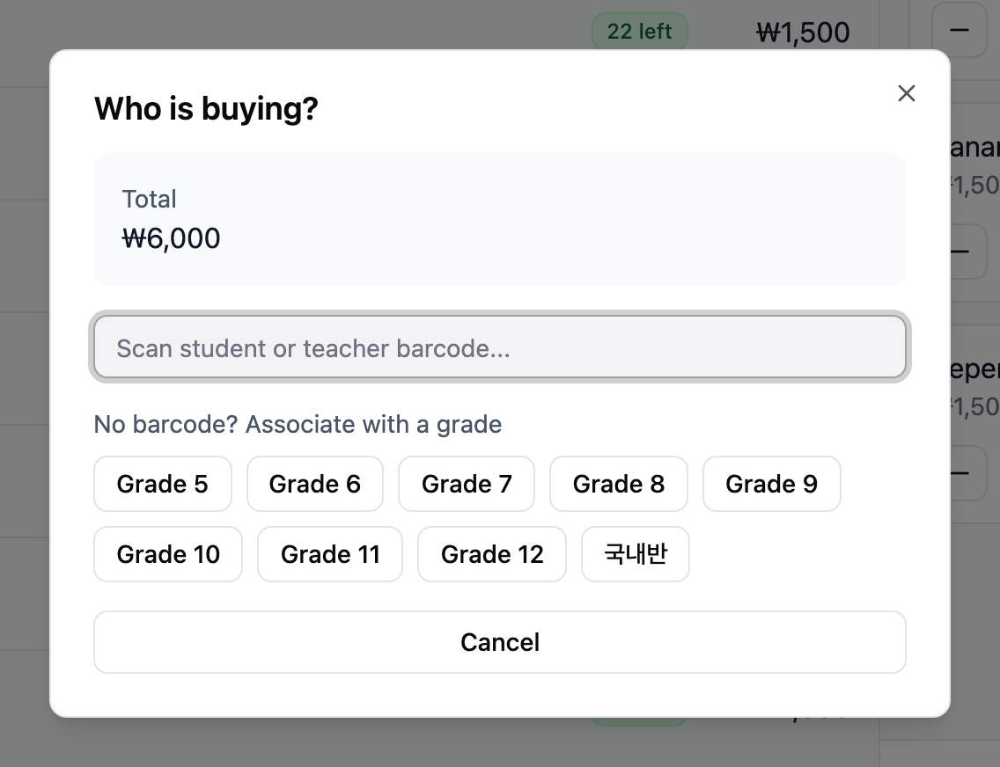</td>
    <td width="33%">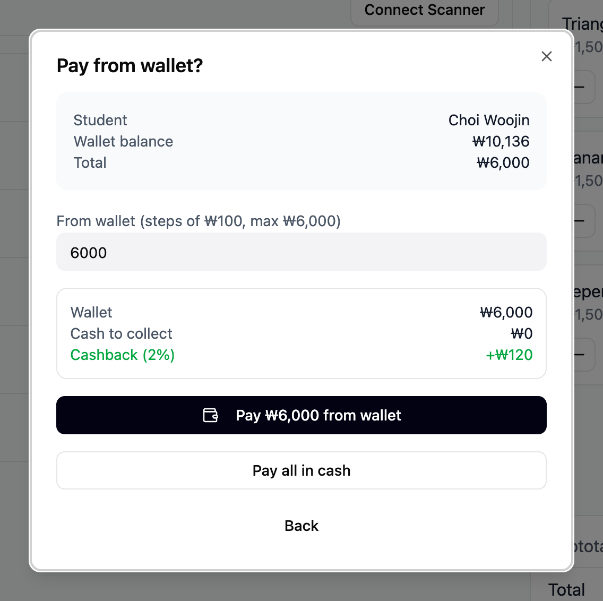</td>
    <td width="33%">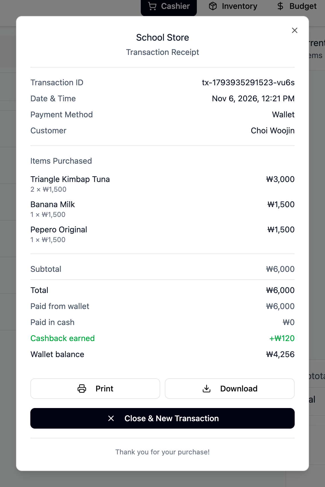</td>
  </tr>
  <tr>
    <td><sub><b>Who is buying?</b> Scan a card or pick a grade.</sub></td>
    <td><sub><b>Pay from wallet?</b> Split between wallet and cash.</sub></td>
    <td><sub><b>Receipt</b> with wallet and cashback lines.</sub></td>
  </tr>
</table>

## Student wallet

Students can hand over cash in advance and spend it later by scanning their card.

- **Charge**: press **Charge student wallet** under the cart, scan the student, enter the cash received (quick buttons for ₩1,000 / ₩5,000 / ₩10,000) and confirm. The dialog shows the balance before and after.
- **Spend**: at checkout the wallet amount defaults to as much as the balance and total allow. Wallet payments go in steps of ₩100.
- **Cashback**: every student purchase, wallet or cash, earns **2%** back into the wallet (rounded down). Revenue figures in Budget and Statistics already subtract cashback.
- **Limits**: charges are in steps of ₩100, up to ₩100,000 at a time, so a mis-scan can't load a huge amount.

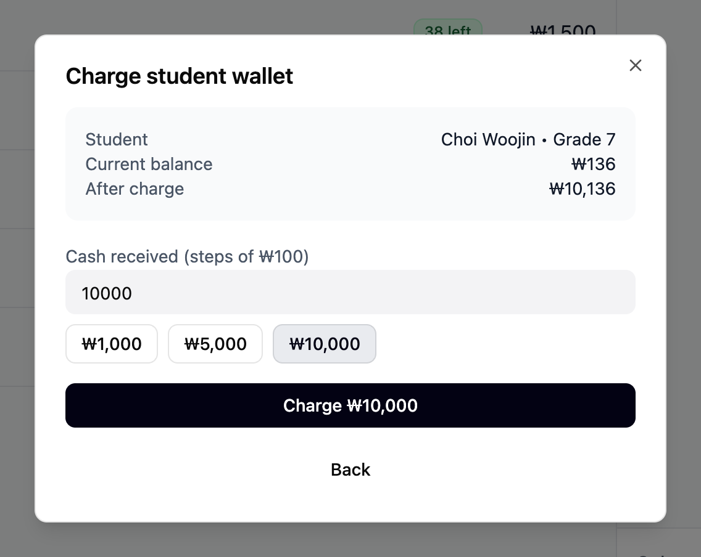

## Teacher self-checkout

Teachers can buy without a staff member present. Print the shared teacher barcode (People → **Teacher barcode**) and keep it by the counter.

- Scanning it on the lock screen opens a stripped-down **Teacher purchase** screen: products and cart only, no other pages, no customer picker, no wallet.
- **Purchase** records the sale as cash under "Teacher" and locks the screen again.
- It also locks after 2 minutes of no activity, or when **Cancel** is pressed.

<table>
  <tr>
    <td width="30%">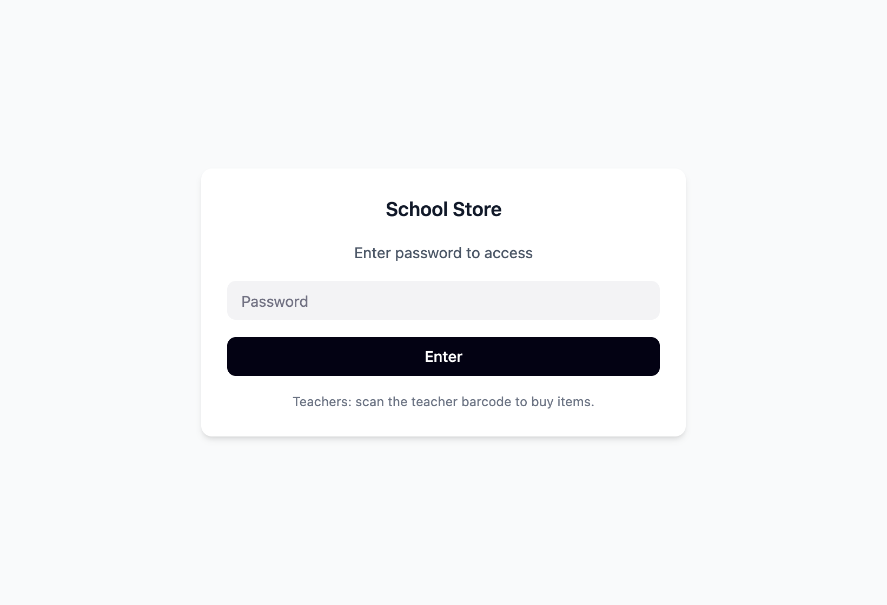</td>
    <td width="70%">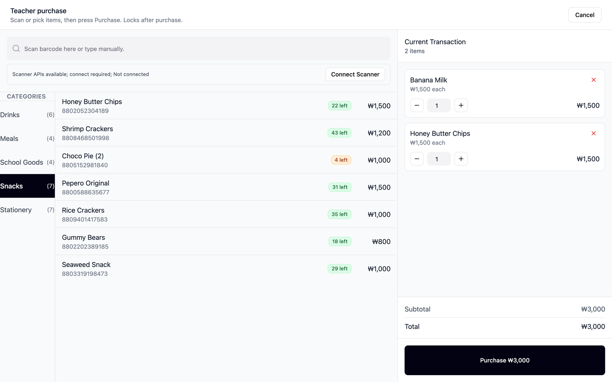</td>
  </tr>
  <tr>
    <td><sub><b>Lock screen</b>: password, or scan the teacher barcode.</sub></td>
    <td><sub><b>Teacher purchase</b>: pick items, press Purchase, done.</sub></td>
  </tr>
</table>

## Inventory

A table of every product with unit cost, price, stock, reorder level, status and last restock. Status turns **Low Stock** below the reorder level and **Out of Stock** at zero. The left column has search (name or barcode), a **Low stock only** filter, a category filter, category management, **Add New Product** and **Export CSV**. Click a product to open its detail pane: current stock, supplier, and its stock history (every sale, restock and correction).

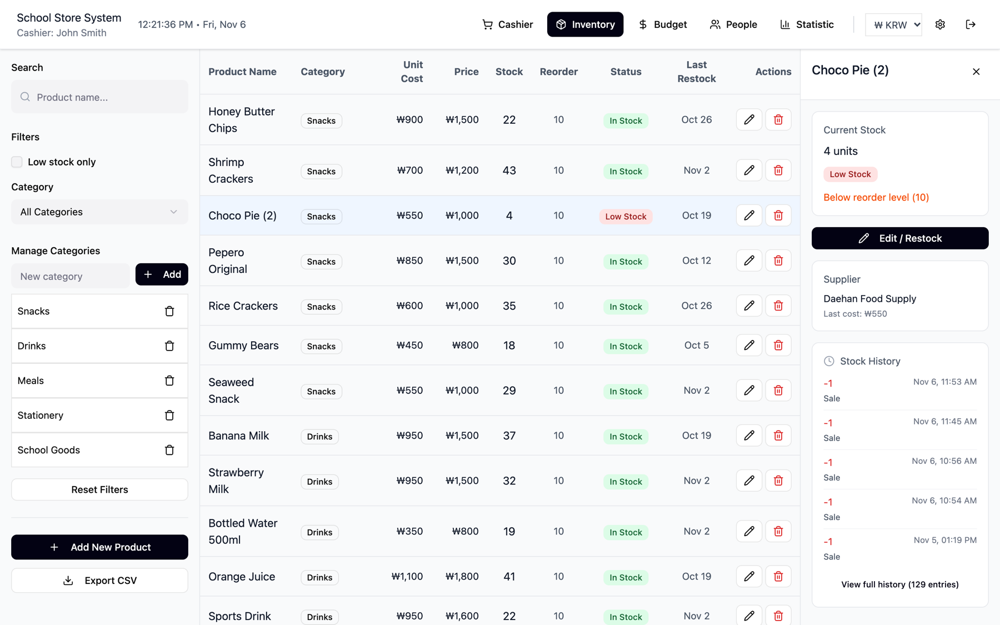

**Edit / Restock** opens the product dialog. The top half edits the product. The **Stock** section records a stock change with a reason: *Restock*, *Inventory correction*, *Damaged items* or *Customer return*. A restock asks for the unit cost and automatically adds an "Inventory Purchase" expense to the Budget. Past sales keep the price and cost they were sold at, so changing a price never rewrites history.

Scanning a barcode on this page opens that product, or starts a new product with the barcode filled in if it's unknown.

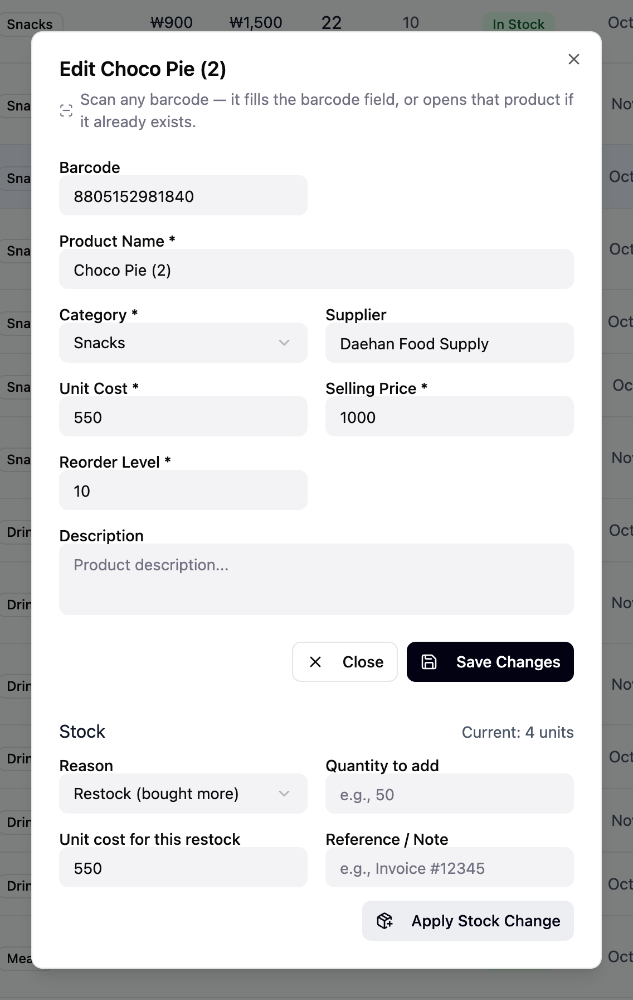

## Budget

Money in and money out for a date range: **Today**, **Yesterday**, **Last 7 Days**, **This Month**, **Last Month**, **All Time** or **Custom**.

- **Cards**: Total Revenue, Total Expenses, Net Profit, Transactions.
- **Revenue vs Expenses** chart by day, with cumulative net profit.
- **Revenue by Product**: units, revenue, days in stock, and sales per in-stock day (so a product that was sold out half the month isn't unfairly ranked).
- **Expenses**: restocks appear automatically; **Add Expense** records anything else (supplies, equipment, utilities...).
- **Transactions**: every sale in the range, expandable to show items.

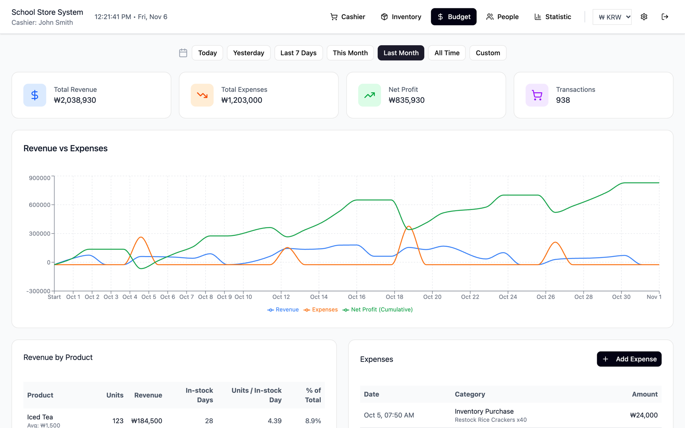

<details>
<summary>Revenue by product, expenses and transactions</summary>

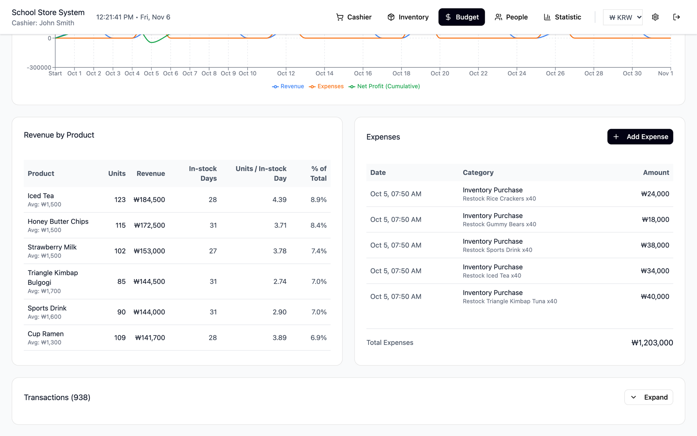

</details>

## People

Students and teachers in one list, with search, filter chips per grade, sort by name or total spent, and each person's total spent and last purchase. Click a person to see their details, barcode card and full purchase history.

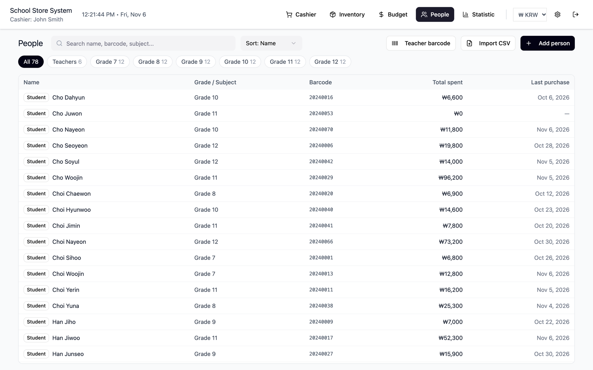

<table>
  <tr>
    <td width="50%">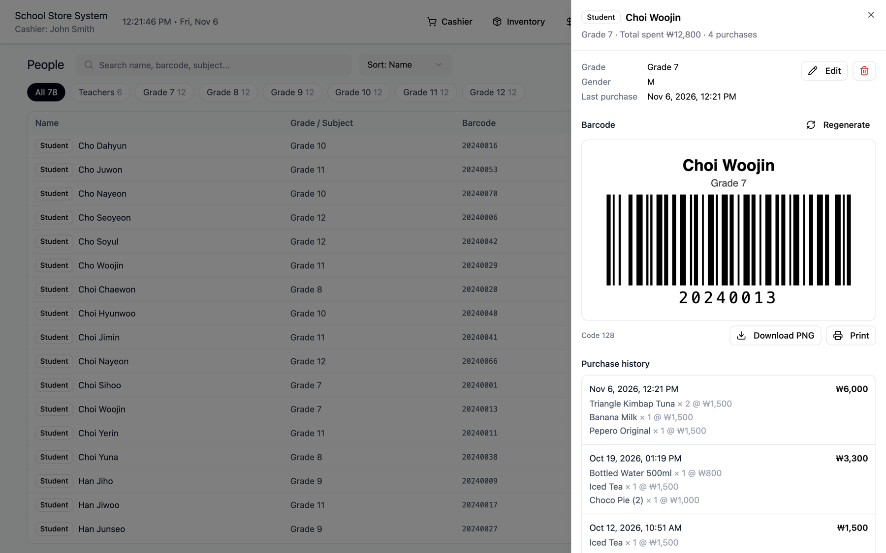</td>
    <td width="50%">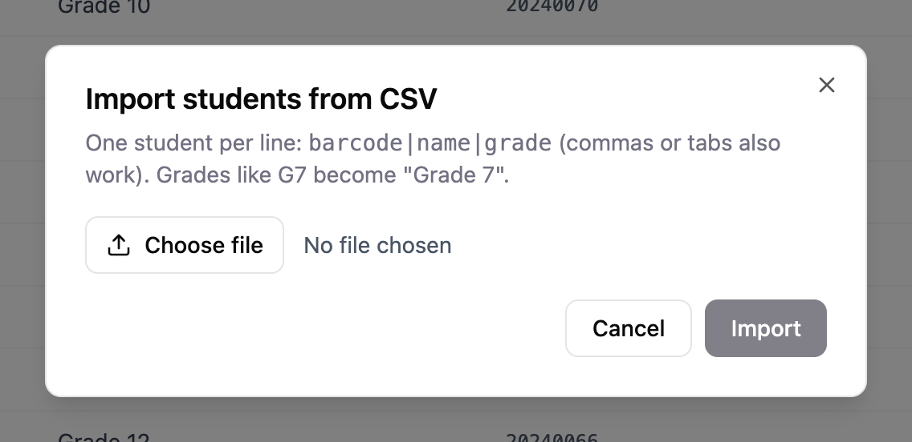<br><br>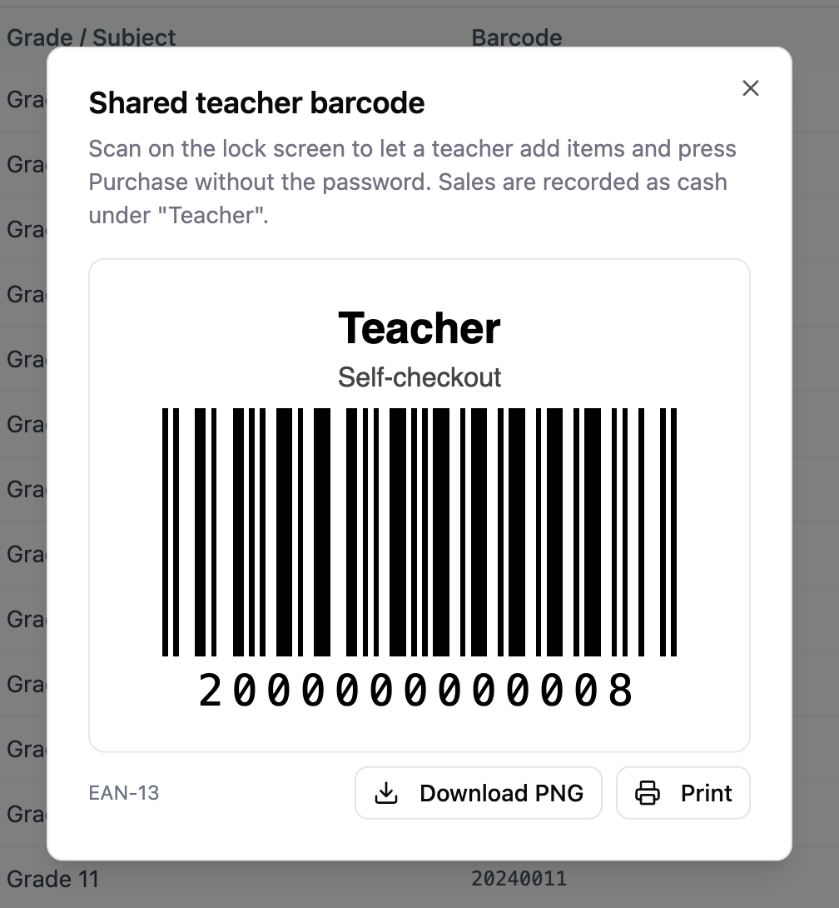</td>
  </tr>
  <tr>
    <td><sub><b>Person panel</b>: edit, barcode card (Download PNG / Print), purchase history.</sub></td>
    <td><sub><b>Import CSV</b> and the <b>shared teacher barcode</b>.</sub></td>
  </tr>
</table>

- **Add person**: student (name, optional ID barcode, grade, gender) or teacher (subject, email; a barcode is generated). **Save & add another** speeds up data entry.
- **Barcode cards**: people without a card can get a generated one; print it or download a PNG.
- **Import CSV**: one student per line as `barcode|name|grade`. Commas, tabs or semicolons also work, a header row is skipped, and grades like `G7` or `7` become "Grade 7". Choose **Add to existing students** (matching barcodes are updated) or **Replace all students** (students missing from the file are removed). Teachers and purchase history are never touched.

```
20240001|Kim Minjun|G7
20240002|Lee Seoyeon|Grade 8
```

## Statistics

How the store is doing, for **Today**, **This Week**, **This Month**, **Last 30 Days** (default), **All Time** or **Custom**. The top row shows Revenue, Profit, Margin, Transactions, Items sold and Average basket, each compared with the period just before. Below are four tabs.

**Sales and profit**: revenue and profit over time (by day, week or month), profit after expenses, the average weekday, profit by category and product, and the 10 best days.

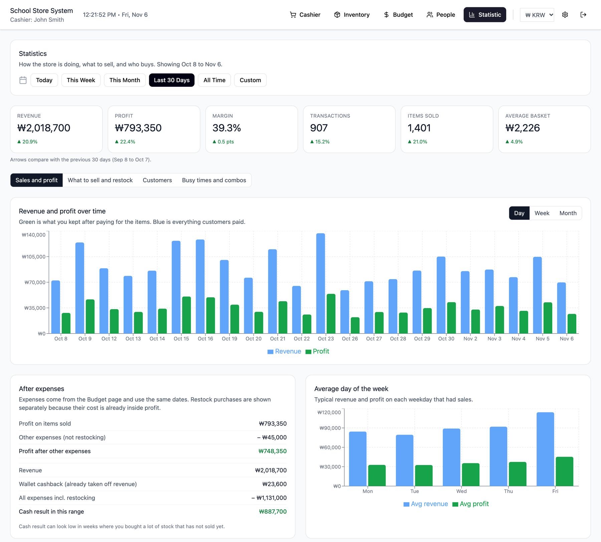

**What to sell and restock**: every product gets a verdict (*Star*, *Busy but thin profit*, *Hidden gem*, *Slow mover*, *Not selling*) with a plain-language reason and how much cash is tied up in its stock. The **Restock list** below flags what will run out soon at the current selling pace and suggests how many to order, with an estimated cost and CSV export.

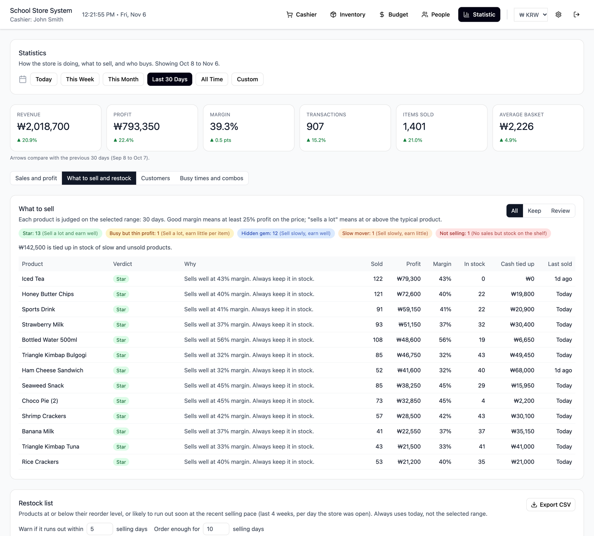

<details>
<summary>Customers, busy times and combos</summary>

**Customers**: named vs anonymous sales, new vs returning buyers, top spenders (students or teachers) and spending by grade.

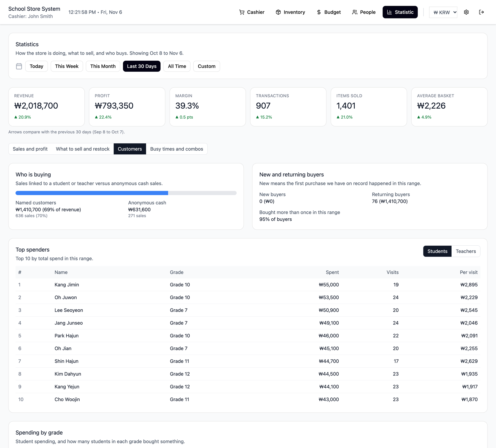

**Busy times and combos**: a heatmap of average sales per school break and weekday (staff the lunch rush), and the product pairs most often bought together (ideas for combo deals).

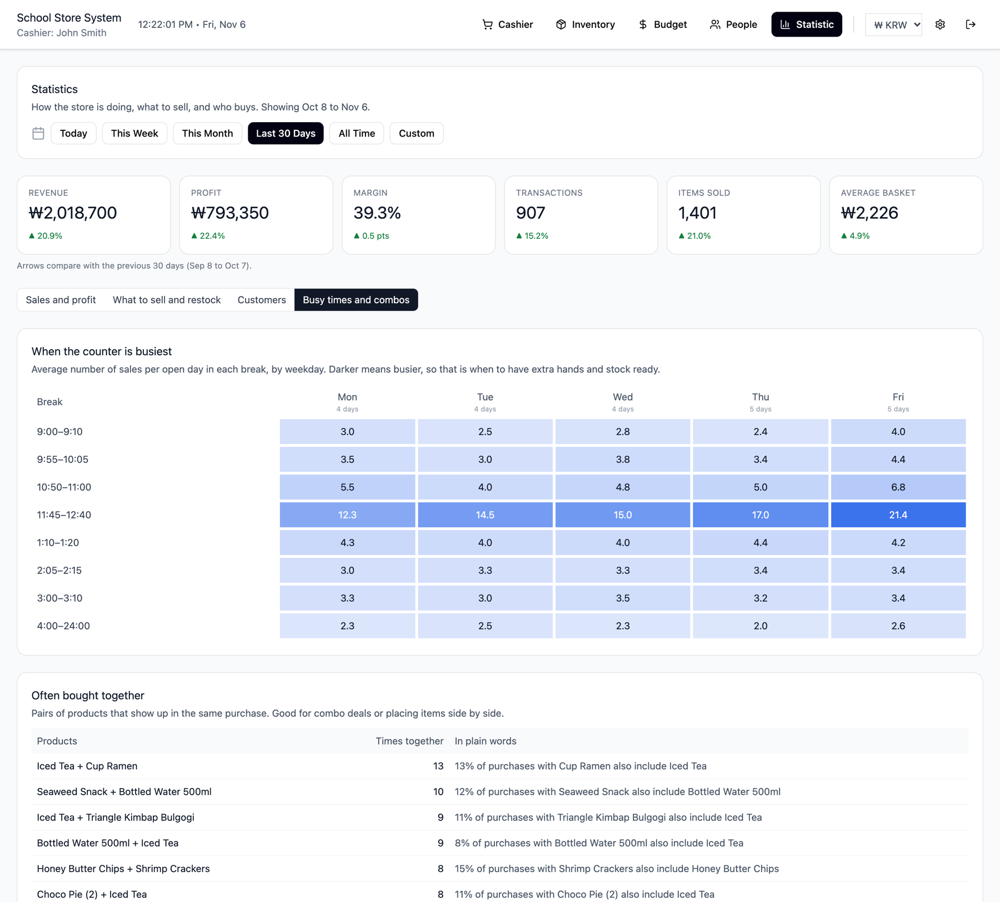

</details>

## Barcode scanners

- **USB keyboard-style scanners work anywhere.** No need to click into a field first; the app recognises a fast burst of digits ending in Enter as a scan and sends it to whatever screen or dialog is open.
- **HID or serial scanners**: when the browser supports it, a **Connect Scanner** button appears on the Cashier page.
- **Product barcodes** must be digits, 8 or 13 long by default (EAN-8 / EAN-13). Both are configurable.
- **Each barcode is unique.** No two products may share one, and no two people (students and teachers together) may share one.
- **Generated barcodes** are EAN-13 starting with `200`, the range reserved for in-store use, so they never clash with real product barcodes.

## Login and sessions

- One shared password (`schoolstore` unless changed, see [Configuration](#configuration)).
- The app locks after **10 minutes** without activity, stretched to **40 minutes** during lunch (12:00 to 12:40) so the rush isn't interrupted.
- The log-out icon in the top bar locks immediately.
- The currency menu in the top bar switches display between ₩ KRW, $ USD and € EUR (formatting only, no conversion).

## Backups and data

All data lives in the browser's IndexedDB on the store computer. Two layers keep it safe:

1. **Disk copy.** While the app runs through `npm run dev` or `npm run preview`, every change is also written to `data/db.json` in the project folder (with a `.bak` of the previous version). On startup, whichever copy holds more sales history wins, so clearing the browser doesn't lose anything.
2. **Backup file.** The gear icon opens **Backup & Restore**. **Download backup** saves a dated `.json` file; **Restore from file** replaces all data after showing what will be restored. A dot on the gear and a reminder appear when the last backup is more than 7 days old.

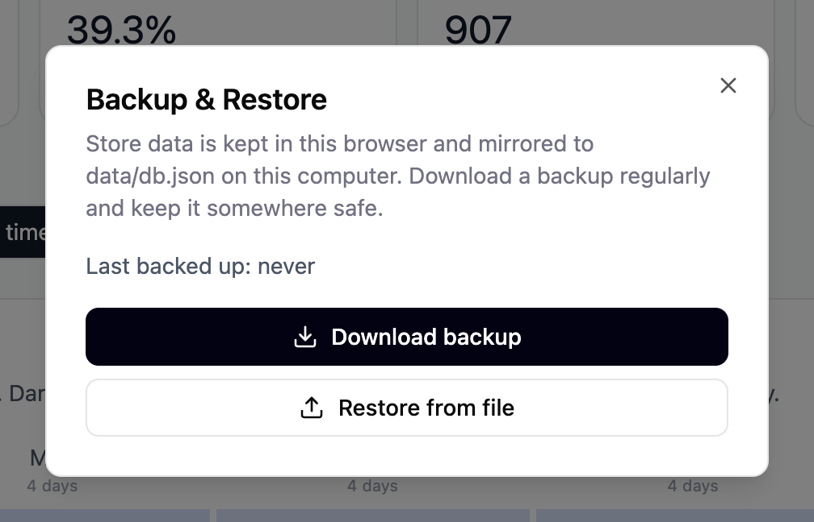

---

## Run it

Requires Node.js.

```bash
npm install
npm run dev      # dev server on http://localhost:3000
npm run build    # production build into build/
npm run preview  # serve the production build
```

Use `dev` or `preview` on the store computer so the `data/db.json` disk copy stays active. A plain static host works too, but then data lives only in the browser.

## Configuration

Optional `.env` variables:

| Variable | Purpose | Default |
| --- | --- | --- |
| `VITE_APP_PASSWORD` | Login password | `schoolstore` |
| `VITE_SCAN_BURST_MAX_INTERVAL_MS` | Max gap between keystrokes for a keyboard-wedge scan | `50` (`100` in the cashier search box) |
| `VITE_BARCODE_ALLOWED_PATTERN` | Regex for valid product barcodes | `^\d+$` |
| `VITE_BARCODE_ALLOWED_LENGTHS` | Comma-separated valid product barcode lengths | `8,13` |

React + Vite + TypeScript, Radix UI + Tailwind. See `CLAUDE.md` for architecture notes.
